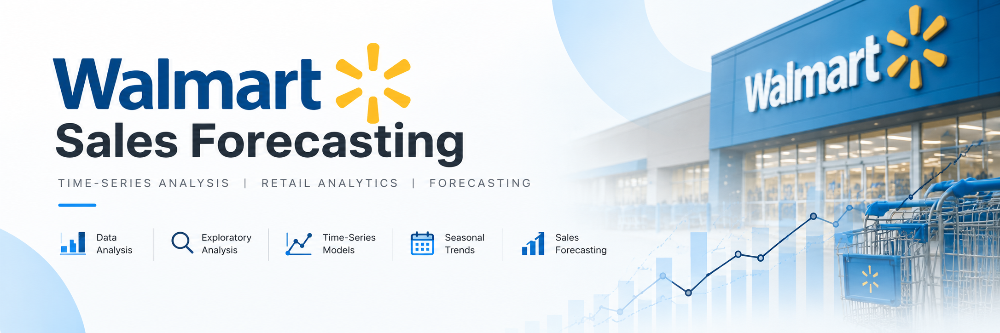
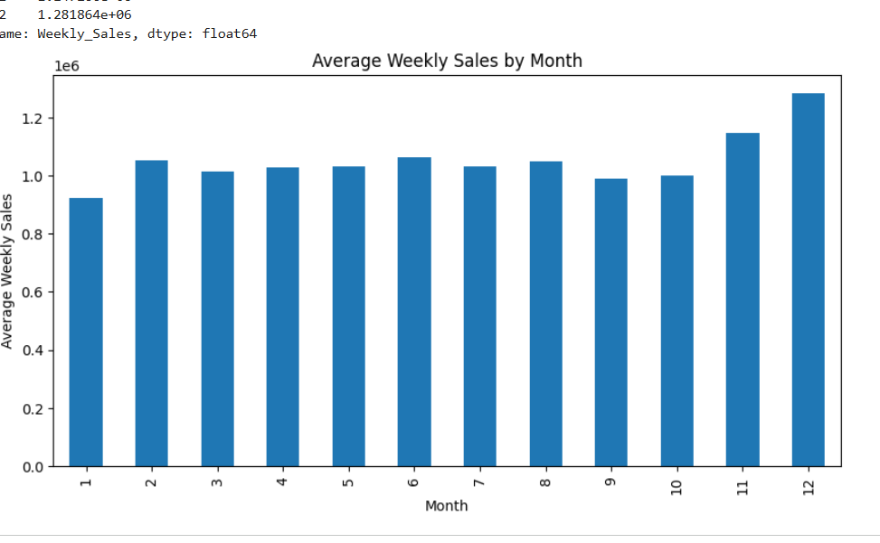
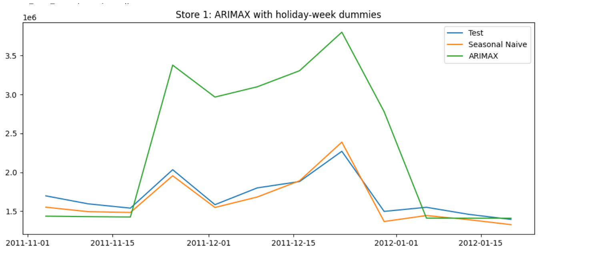
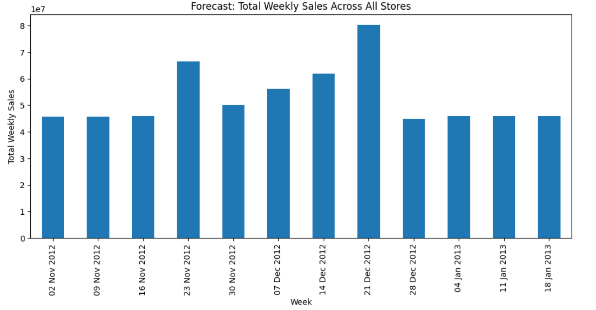

<p align="center">
  
</p>


# Walmart Sales Forecasting

A time-series analysis and sales forecasting project focused on exploring historical Walmart weekly sales, identifying seasonal patterns, and evaluating forecasting models across multiple stores.

## Technologies Used

<p align="center">
  
  
  
  
  
  
  
  
</p>

## Quick Navigation
<p align="center">
  <a href="#project-overview"></a>
  <a href="#objectives"></a>
  <a href="#methodology"></a>
  <a href="#visualizations"></a>
  <a href="#model-performance"></a>
  <a href="#getting-started"></a>
  <a href="#connect-with-me"></a>
</p>

## Project Overview

Retail sales forecasting helps businesses understand demand patterns and make better inventory, staffing, and operational decisions.

This project analyzes Walmart weekly sales data across **45 stores**, explores sales trends and holiday effects, and compares statistical forecasting models to evaluate their performance on historical sales data.

## Objectives

- Perform exploratory data analysis (EDA) on weekly sales data.
- Identify seasonal trends and patterns in retail sales.
- Analyze correlations between numerical variables.
- Investigate potential outliers using the Interquartile Range (IQR) method.
- Build and evaluate time-series forecasting models.
- Compare ARIMA, ARIMAX, and Seasonal Naive forecasting approaches.

## Tech Stack

- **Language:** Python
- **Data Analysis:** NumPy, Pandas
- **Visualization:** Matplotlib, Seaborn
- **Time-Series Modeling:** Statsmodels
- **Model Evaluation:** Scikit-learn
- **Environment:** Google Colab / Jupyter Notebook

## Project Structure

```text
walmart-sales-forecasting/
├── assets/
│   ├── arimax-vs-seasonal-naive.png
│   ├── monthly-sales-seasonality.png
│   └── total-sales-forecast.png
├── .gitignore
├── README.md
├── requirements.txt
└── walmart_sales_forecasting.ipynb
```

## Methodology

1. **Data Preparation:** Load, inspect, and prepare the historical sales data for analysis.
2. **Exploratory Data Analysis:** Examine sales distributions, correlations, outliers, and seasonal trends.
3. **Feature Analysis:** Investigate the relationship between sales, holidays, and other available variables.
4. **Forecasting:** Develop ARIMA, ARIMAX, and Seasonal Naive models.
5. **Model Evaluation:** Compare forecast predictions with actual sales using RMSE and MAPE.
6. **Multi-Store Analysis:** Examine combined weekly sales forecasts across the 45 stores.

## Visualizations

### 1. Monthly Sales Seasonality

Explores how average weekly sales vary across months and helps identify seasonal sales patterns.



### 2. Forecast Model Comparison

Compares ARIMAX and Seasonal Naive predictions against actual sales over the evaluated test period.



### 3. Total Weekly Sales Forecast

Visualizes the combined weekly sales forecast across all 45 stores.



## Model Performance

The following are the evaluation results recorded during the project analysis. Lower RMSE and MAPE values indicate better predictive performance on the evaluated data.

| Model | RMSE | MAPE |
|---|---:|---:|
| ARIMA (1,0,1) | ~304K | ~11.0% |
| Seasonal Naive | ~94K | ~5.2% |
| ARIMAX — Holiday Weeks 47–52 | ~100K | ~5.1% |
| ARIMAX — Weeks 1–4 and 47–52 | ~106K | ~5.7% |

*Note: These results correspond to the evaluated periods and configurations. Model performance may vary across stores and test windows.*

## Key Findings

- Weekly sales exhibit seasonal variation, making time-series analysis useful for retail forecasting.
- The Seasonal Naive model performed substantially better than the evaluated ARIMA model on the reported metrics.
- ARIMAX provided a way to incorporate additional explanatory variables, including holiday-related information.
- Forecasting performance should be evaluated against a suitable baseline rather than assuming a more complex model is always better.
- Correlation does not establish causation, and statistical outliers may represent genuine retail events rather than data errors.

## Getting Started

### Prerequisites

- Python 3.10 or a compatible Python environment
- Jupyter Notebook or Google Colab
- The dataset required by the notebook

### Run on Google Colab

1. Open the notebook in Google Colab.
2. Upload or connect the required dataset.
3. Install any missing dependencies listed in `requirements.txt`.
4. Run the notebook cells in order.

### Run Locally

1. Clone the repository:

   ```bash
   git clone https://github.com/YOUR_USERNAME/walmart-sales-forecasting.git
   ```

2. Move into the project directory:

   ```bash
   cd walmart-sales-forecasting
   ```

3. Create and activate a virtual environment:

   ```bash
   python -m venv .venv
   ```

   On Windows:

   ```bash
   .venv\Scripts\activate
   ```

   On Linux/macOS:

   ```bash
   source .venv/bin/activate
   ```

4. Install the dependencies:

   ```bash
   pip install -r requirements.txt
   ```

5. Launch Jupyter Notebook:

   ```bash
   jupyter notebook
   ```

6. Open `walmart_sales_forecasting.ipynb` and run the cells in sequence.

## Limitations

- Forecast accuracy depends on the selected test period, available historical data, and model assumptions.
- Statistical convergence warnings may occur for certain store-level ARIMAX models.
- Holiday effects and correlations should not be interpreted as proof of causation.
- Results from historical data do not guarantee future sales performance.

## Future Improvements

- Tune forecasting model parameters systematically.
- Investigate additional time-series models and forecasting baselines.
- Perform consistent validation across individual stores.
- Explore additional explanatory variables where suitable data is available.

## Author

**Samarth Boraste**  
## Connect with Me

<p align="center">
  <a href="https://www.linkedin.com/in/samarthb77/">
    
  </a>
  <a href="https://github.com/samarthboraste">
    
  </a>
</p>

*This project was developed for learning and practical exploration of retail sales analysis and time-series forecasting.*
